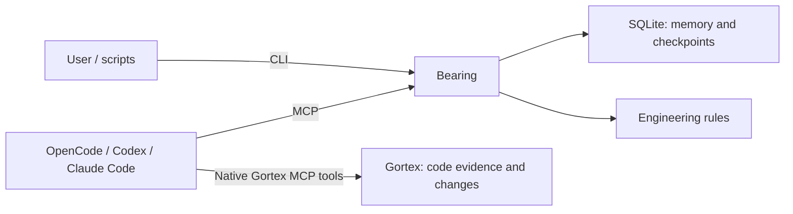

# Bearing

Product design · Updated 21 October 2026

Repository: [MuiGoku123432/Bearing](https://github.com/MuiGoku123432/Bearing)

Implementation: [BUILD_PLAN.md](BUILD_PLAN.md) defines the ordered build and acceptance criteria. [CONTRACT.md](CONTRACT.md) defines concrete v0.1 commands, records, validation, and defaults. Those documents resolve the implementation choices discussed more broadly here.

Research: [findings and source documents](research/README.md), including [implementation recommendations](research/08-recommendations.md). Research recommendations remain proposals until validated; they do not imply dependencies have been installed.

Bearing is a native Go coding-agent tool with SQLite storage and MCP support. It gives OpenCode, Codex, and Claude Code built-in engineering policy, useful task context, durable memory, progress recovery, and evidence-based completion. Agents use Bearing alongside Gortex: Bearing preserves outcomes, decisions, and evidence; Gortex supplies current code evidence and guarded code operations.

Go, SQLite, MCP support, Gortex integration, and the name Bearing are approved choices. The pinned dependencies are `modernc.org/sqlite` and the official MCP Go SDK.

## Core requirements

- Support all three consumers through the same Bearing operations and stored records.
- Apply [ENGINEERING.md](ENGINEERING.md) to Bearing's own development and to work carried out with Bearing. It preserves the user's original rules verbatim.
- Keep instructions, command output, progress reports, and errors simple, direct, and easy to understand.
- Preserve useful knowledge across sessions, interruptions, and context compaction.
- Retrieve relevant context selectively and measure total token usage and task quality.
- Use Gortex for code discovery, reuse checks, relationships, impact analysis, and guarded changes.
- Borrow explicit outcomes, small steps, resumable state, and real verification from GSD. Ordinary tasks should not require phase documents, repeated interviews, or automatic review loops.

## Engineering rules are part of the product

`ENGINEERING.md` is the canonical rule text. `AGENTS.md` points contributors to it. Bearing will embed that complete text in the Go executable and expose it through the CLI and MCP with a policy version or content hash, so every consumer receives the same standards. This is a core tool capability, not optional documentation. The database stores task progress and memory, not an independently editable copy of those rules.

The workflow must apply the rules at useful points:

| When | Required behavior |
| --- | --- |
| Start or resume | Load the complete engineering rules in the active context and retrieve the relevant task state; a prior session's acknowledgement is not sufficient after context reset |
| Before adding code | Query Gortex for an existing equivalent and follow neighboring conventions |
| Before adding dependencies or architectural layers | Explain the need in the plan and obtain confirmation; remember approvals already given |
| During implementation | Keep single-use logic local, follow the rule of three, and implement only the current need |
| Before finishing | Review the actual diff against all five self-review checks in ENGINEERING.md; record a concise review outcome and relevant verification evidence |

Bearing can require fields, validate state changes, and preserve evidence. It cannot prove that a model made a good design choice just because the model checked a box. Code review and actual tests remain necessary. Rule changes are explicit source changes reviewed with the project; recalled memories cannot silently rewrite them.

## Architecture

One `bearing` executable runs CLI commands and, with `bearing mcp`, a local MCP server over standard input/output. Both interfaces invoke the same concrete memory and checkpoint operations. There is no separate agent runtime, storage abstraction, plugin system, or duplicate code index in the first version.

Keep command parsing, persistence, and MCP handling separate where they have real responsibilities. Start with a small Go module and plain functions. Add packages and files when the implementation needs them; do not generate a framework-shaped directory tree before there is code to organize.

### Working alongside Gortex

| Responsibility | Owner |
| --- | --- |
| Current source, symbols, dependencies, and callers | Gortex |
| Search for reusable code and inspect change impact | Gortex |
| Source edits and post-change graph checks | Gortex under its active policy |
| Decisions, constraints, lessons, and user corrections | Bearing |
| Task state, checkpoints, next actions, and verification records | Bearing |
| Engineering workflow and clear communication | Bearing's rules and consumer instructions |
| Running the model, permissions, tools, and tests | The existing consumer and project environment |

Connect each consumer to both Bearing and Gortex. Bearing records Gortex symbol/file references and the checkout/revision associated with evidence. On resume, the agent uses those references to fetch current evidence through Gortex before changing code. Do not proxy Gortex's whole API through Bearing or duplicate its graph.

Bearing memory is self-contained. Decisions, constraints, lessons, preferences, and user corrections are saved in Bearing and recalled from Bearing, whether or not Gortex is available or keeps similar notes. Bearing does not import, synchronize with, or defer to Gortex memories, and they are not part of Bearing recall. If an active Gortex policy also requires its own memory write, the agent may do both; the Bearing record stays complete on its own.

If Gortex is unavailable, Bearing's memory and checkpoint commands still work. Code work must follow the active Gortex failure policy and report the missing integration rather than silently replacing graph checks with file searches. Ordinary setup must not start or restart the machine-wide daemon.

### SQLite storage

Initial scope is local Git repositories. The v0.1 storage location is `.bearing/state.db` in the checkout, ignored by Git. All three clients working in that checkout use the same database. Keep writable state out of `.git`, which agent environments may protect. Bearing works on branches in the main checkout and refuses linked worktrees, because removing a worktree deletes its ignored Bearing state. Bind MCP startup to an explicit repository path; CLI commands may resolve the current repository. Fail clearly when the project cannot be resolved or the state directory is not writable.

Use three concrete record types:

| Record | Contents |
| --- | --- |
| Memory | ID, kind, claim, source/evidence, applicability, file/symbol anchors, revision context, timestamps, and replacement/retraction state |
| Task | ID, outcome, observable acceptance criteria, status, checkout context, latest checkpoint reference, and update version |
| Checkpoint | Task ID, completed work, unresolved questions, failed attempts, verification results, next action, and revision/working-tree context |

Repository-wide knowledge and checkout-specific observations must be distinguishable. A branch name alone is not proof that evidence is current. No global or cross-repository retrieval is enabled implicitly. Cross-machine synchronization is outside the first version.

Use transactions for checkpoint/task updates and memory replacement. Return success only after commit. Validate an expected update version to reject conflicting writes, and use request IDs to make retried writes idempotent. Bound lock waits and return a clear retryable error rather than losing work.

Record request receipts atomically with writes. A lost response does not establish that a write failed; retrying the same request and payload must resolve to the original result. Reject reuse of a request ID with a different payload.

SQLite serializes writers; multiple client processes therefore need short transactions and explicit busy/conflict handling. Choose and test journal and synchronization settings against the durability requirements before claiming restart safety. Backups and exports must capture a consistent database state rather than copying an active database file without its journal. [SQLite isolation](https://sqlite.org/isolation.html)

Track schema versions, apply migrations transactionally, and reject a newer unsupported schema without changing it. Add consistent logical export, physical backup, and restore into an empty destination. Logical import/merge and replacing live state are deferred in v0.1. Test recovery using isolated Bearing processes; never restart unrelated infrastructure to test it.

Research recommends testing WAL with FULL synchronization on local filesystems. Before using WAL, verify the built binary's embedded SQLite includes the WAL-reset fix: 3.51.3 or later, or an applicable patched backport. Driver version alone is not sufficient. See [storage findings](research/02-go-sqlite-storage.md).

### CLI and MCP

Keep a small operation set with matching behavior across both interfaces:

| CLI operation | Purpose | MCP operation |
| --- | --- | --- |
| `bearing start` | Create a task with outcome/acceptance criteria and return initial context with policy | `bearing_start` |
| `bearing resume` | Return policy, the selected task, latest checkpoint, relevant memories, and revalidation warnings | `bearing_resume` |
| `bearing remember` | Save, correct, supersede, or retract a durable fact | `bearing_remember` |
| `bearing recall` | Retrieve a bounded set of relevant memories | `bearing_recall` |
| `bearing checkpoint` | Save progress, evidence, and the next action | `bearing_checkpoint` |
| `bearing finish` | Validate acceptance results, verification, and engineering self-review; record completion | `bearing_finish` |
| `bearing git` | Inspect Git state, create and switch Conventional Branches, and commit reviewed staged changes off the trunk | `bearing_git` |
| `bearing rules` | Return the canonical engineering and communication rules | `bearing_rules` |

These operations are implemented. [CONTRACT.md](CONTRACT.md) defines request fields and CLI shapes. `bearing mcp` starts the protocol server; initialization, setup output, inspection, export, backup, and restore remain maintenance commands rather than additional always-advertised agent tools.

CLI output is short readable text by default, with explicit JSON output for scripts. MCP returns structured results with concise text, stable IDs, and visible truncation. Reserve stdout for MCP protocol traffic and send diagnostics to stderr. A tool must report errors as errors.

## Workflow

1. **Orient.** Establish the requested outcome, current repository and checkout, applicable instructions, relevant memories, and any matching unfinished task.
2. **Understand.** Use Gortex to locate the affected behavior, reusable equivalents, callers, constraints, and verification commands. Establish the relevant ownership boundary, data flow, and failure modes; inspect only the system context needed for the change. Ask only questions whose answers change the work.
3. **Choose the next useful change.** For a small fix, a sentence is sufficient. For substantial work, keep a short sequence of independently verifiable steps.
4. **Implement.** Follow the active Gortex change contract, make the smallest reasonable change, and avoid opportunistic additions.
5. **Verify.** Run the relevant real checks and inspect the diff against the engineering standards. A proposed test target or graph guard is not a passing test.
6. **Preserve and continue.** Save new durable decisions in Bearing promptly. Update checkpoints at useful boundaries. Report the result, evidence, and remaining limitation.

A small fix may need only an outcome and a final checkpoint. Substantial work may use a short sequence of independently verifiable steps. Clarify only decisions that affect the work, and do not ask again for an approval already given.

Pure localization requests must respect Gortex's terminal `answer_ready` contract, including its stop condition; do not require a subsequent Bearing write. Diagnosis and modification use the Gortex task flow. Preserve mandatory Gortex checks without adding duplicate wrapper checks.

### Simple and direct language

- Lead with what changed, what was learned, or what needs a decision.
- Use short sentences, familiar words, and concrete actions.
- Explain a technical term when it helps the user make a decision.
- Say what failed and how to recover: “Memory was not saved. The database is busy. Retry the command.”
- Avoid slogans, process jargon, repeated plans, and filler.
- Keep routine progress brief. Show detail when the user requests it or when it affects correctness.
- Apply the same style to help text, errors, tool descriptions, skills, checkpoints, and final reports.

### Memory rules

- Save decisions, verified constraints, useful corrections, failed approaches with evidence, and costly-to-rediscover operational facts.
- Each durable record needs a claim, scope, evidence/source, and validation context. Distinguish a user instruction, an observed result, and an inference. A checkpoint also needs a clear next action.
- Record unresolved hypotheses as hypotheses in working notes. Do not silently promote them into project rules.
- Retrieve by task and affected symbols/files. Load short results first, then expand the records needed for the decision.
- Revalidate code-dependent facts through Gortex against the active checkout before relying on them. Saving a fact does not establish its freshness.
- Supersede conflicting records explicitly. Avoid accumulating contradictory instructions or repeated summaries of the same decision.
- Keep recalled material as evidence; it does not override the current user request or governing instructions.
- Avoid storing credentials, full transcripts, or source-code copies as durable memory.
- After a failed memory write, report that persistence failed. Do not imply that the next session will recover it.

### Token usage rules

- Ensure the full engineering rules are available before coding in each active context. Start/resume supplies them; routine progress writes return only their identity. Keep other always-loaded guidance short and put the detailed procedure in one on-demand skill initially.
- Retrieve a bounded working set instead of a full repository map or entire memory history.
- Use structural summaries to navigate, then inspect full relevant implementations before editing.
- Reuse evidence within the task; re-fetch when the underlying revision or working tree changes.
- Preserve required invariants when reducing context. If results are truncated, expose that fact and fetch the missing evidence when needed.
- Checkpoint at completed steps, corrections, handoffs, and planned compaction. Hooks may reinforce this, but a crash can happen before an end-of-session hook.
- Default to one agent. Add delegation only for a concrete independent task when authorized and useful.
- Measure total input/output tokens, cached input where available, wall time, tool calls, and correctness. Response byte counts are a proxy, not an exact token count.

Initial tuning targets: about 1,000 tokens of Bearing-owned startup guidance and about 1,500 tokens of retrieved memory/checkpoint context. These are adjustable targets, not measured savings or limits on necessary code evidence. Never remove an applicable engineering rule to hit the target. Host system prompts and unrelated tooling are measured separately.

Start retrieval with scope, file/symbol anchors, and text matching. Measure misses before adding embeddings or a second index. Return ranked excerpts and IDs for expansion, and state when the response is incomplete.

## Dependencies and consumer setup

Go, SQLite, and MCP are approved technology choices. Two packages are pinned:

| Dependency | Why it is needed |
| --- | --- |
| [Official MCP Go SDK](https://github.com/modelcontextprotocol/go-sdk) v1.8.0 | Implement the supported protocol and transports without writing a second MCP implementation |
| [modernc.org/sqlite](https://pkg.go.dev/modernc.org/sqlite) v1.60.1 | SQLite without a C toolchain; the built binary embeds SQLite 3.53.4, which includes the WAL-reset fix |

Use Go's standard library for command parsing, SQL access, JSON, paths, and ordinary tests where sufficient. Do not add an ORM, CLI framework, vector database, or orchestration framework to the initial build.

| Consumer | Instructions and skill loading | Connection |
| --- | --- | --- |
| Codex | `AGENTS.md` and `.agents/skills` | Bearing MCP plus existing Gortex MCP |
| Claude Code | `CLAUDE.md` imports and `.claude/skills` | Bearing MCP plus existing Gortex MCP |
| OpenCode | `AGENTS.md`; supports `.agents/skills` and `.claude/skills` | Bearing MCP plus existing Gortex MCP |

Distribute one canonical workflow and rule set through the consumers' documented mechanisms. Verify discovery and duplicate loading on each consumer. Setup must merge only its own configuration and preserve unrelated settings. Optional lifecycle hooks come later if manual checkpoint boundaries prove insufficient.

Sources: [Codex instructions](https://learn.chatgpt.com/docs/agent-configuration/agents-md), [Codex skills](https://learn.chatgpt.com/docs/build-skills), [Codex MCP](https://learn.chatgpt.com/docs/extend/mcp?surface=cli), [Claude instructions](https://code.claude.com/docs/en/memory), [Claude skills](https://code.claude.com/docs/en/skills), [Claude MCP](https://code.claude.com/docs/en/mcp), [OpenCode rules](https://opencode.ai/docs/rules/), [OpenCode skills](https://opencode.ai/docs/skills/), and [OpenCode MCP](https://opencode.ai/docs/mcp-servers/).

## Acceptance criteria

Test Bearing storage in temporary directories. Use a disposable tracked project for Gortex integration; obtain explicit tracking authorization before registering it. Keep experimental records out of unrelated repositories.

| Scenario | Required result |
| --- | --- |
| Engineering rules | The binary exposes the complete canonical rules and their identity; fresh and resumed contexts in all three consumers receive them; reuse and self-review are demonstrated on actual tasks |
| Cross-tool handoff | One client records a decision and unfinished task in Bearing; fresh sessions in the others recover the same records and next action |
| CLI/MCP parity | Both interfaces read and update the same records with matching validation, IDs, and failure behavior |
| Restart | Acknowledged writes remain readable after a Bearing process restart; interruptions do not leave partial checkpoint/task updates |
| Correction | A corrected fact replaces the old one in normal recall while preserving inspectable provenance |
| Repository and branch scope | Unrelated repository facts do not leak into recall; branch-specific evidence is excluded or clearly flagged when the checkout changes |
| Existing-code reuse | A task with an existing equivalent finds and uses it before adding another implementation |
| Stale evidence | Changing the relevant code causes revalidation; an old memory cannot establish current behavior by itself |
| Context pressure | Relevant facts survive many irrelevant notes within the configured retrieval budget; omitted information is not presented as an exhaustive result |
| Verification failure | A failing check leaves the task unfinished, with the failure and next step recoverable |
| Repeated or concurrent writes | Retried requests avoid duplicate records; stale versions fail clearly without overwriting another client's progress |
| Recovery and migration | Backup/restore preserves scopes and replacement relationships; logical export exposes inspectable records; migrations preserve existing records and reject unsupported newer schemas |
| Gortex failure | Bearing memory remains accessible; code work reports the integration failure and honors the active policy |
| Plain language | Help, errors, and handoffs state the action and next step clearly without requiring the user to understand internal architecture |

Compare the same small repair, reuse task, and interrupted feature under Gortex, Gortex with a short handoff note, and Bearing with Gortex. Preserve the engineering rules and applicable native Gortex memory in every condition. Hold the consumer/model and task fixture constant; repeat comparisons before claiming savings. Evaluate correctness first, then recovery quality, then total token/time cost. No savings percentage is established yet. See [the evaluation plan](research/07-evaluation.md).

## Build order

Follow [BUILD_PLAN.md](BUILD_PLAN.md): durable CLI task and embedded policy; useful memory and completion; MCP with one real coding-agent integration; all-consumer handoffs; recovery hardening; measured release readiness.

The first working product milestone is a verified Gortex-backed coding task through Bearing in one real consumer. The complete v0.1 acceptance story adds fresh-session handoffs across all three consumers and tested recovery.

## Research retained from the first pass

The installed Gortex guide and live schemas expose durable memories, symbol/file anchors, explicit supersession, selective recall, notebooks, and session-note summaries. These establish useful integration points, not guarantees about branch isolation or crash recovery. Bearing must reuse code intelligence and preserve provenance without duplicating that functionality.

Local sources inspected on 20 October 2026: `gortex guide`; MCP `capabilities` for `remember.memory`, `remember.notebook`, `recall.surface`, and `recall.distill`. Gortex was reported as `0.64.5+3310720`. The guide includes legacy names; use mounted tools and live schemas during implementation.

Observed consumer versions were Codex `0.163.0`, Claude Code `2.1.263`, and OpenCode `1.18.33`. Test actual installed versions rather than assuming the newest web documentation describes their behavior.

Useful references: [GSD architecture](https://github.com/gsd-build/get-shit-done/blob/main/docs/ARCHITECTURE.md) for small executable steps and persistent state; [Anthropic context engineering](https://www.anthropic.com/engineering/effective-context-engineering-for-ai-agents) for selective retrieval and external notes; [MCP architecture](https://modelcontextprotocol.io/docs/2026-07-28/learn/architecture) for the separation between tool interfaces and storage.

## Current state

Bearing is a working developer preview on macOS arm64: the executable, SQLite store, eight MCP tools, CLI, setup and installer, and recovery commands are implemented and tested. Fresh-session handoffs across the three consumers and the comparative evaluation remain before a v0.1 release. See [IMPLEMENTATION.md](IMPLEMENTATION.md) for verified behavior and remaining release gates.
