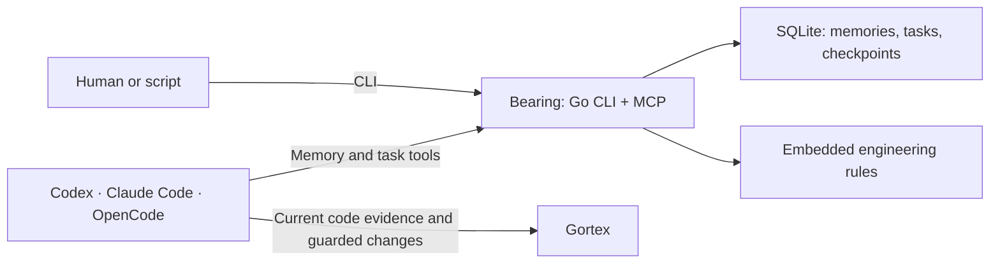

# Bearing research

Completed: 20 October 2026.

Implementation now follows [BUILD_PLAN.md](../BUILD_PLAN.md) and the [v0.1 agent contract](../CONTRACT.md). This folder preserves the research and its original recommendations; the build documents resolve the first version's concrete choices.

Bearing should preserve the decisions and unfinished work that help an agent continue correctly. It should deliver the user's engineering standards as a built-in capability, while Gortex remains the source of current code evidence.

This folder contains research findings, design recommendations, and tests needed to validate them. It is reference material for building Bearing, not a set of documents every task must create or load.

## Main findings

1. **Build the engineering standards into the tool.** Embed the complete canonical `ENGINEERING.md` in the executable, expose it through CLI/MCP, deliver it at start/resume, and preserve review evidence at completion. Storage checks and engineering judgment need different forms of validation.
2. **Gortex already has memory.** Its live schemas include durable records, anchors, supersession, and bounded recall. Bearing needs to demonstrate added value through task continuity, recovery, and consistent behavior across consumers. See [the Gortex findings](05-gortex-integration.md).
3. **Memory needs correction and scope.** Save claims with evidence and applicability. A newer record is not automatically more correct. A remembered code fact must be revalidated against the active checkout.
4. **SQLite fits the proposed workload, with explicit guarantees.** Short transactions, conflicting-update detection, and persistent request receipts address multiple clients and uncertain retries. Verify the embedded SQLite engine includes the documented WAL-reset fix. See [storage research](02-go-sqlite-storage.md).
5. **Small context is a hypothesis to measure.** More instructions and longer histories do not automatically improve results. Keep the mandatory rules, remove duplication, and measure total task cost rather than one retrieval call.
6. **MCP does not make host behavior uniform.** Rule loading, skill discovery, hooks, and result rendering differ. Test the actual Codex, Claude Code, and OpenCode versions.
7. **A simple handoff note is a serious baseline.** Bearing should earn its additional machinery by improving continuity or reducing repeated work while preserving correctness.

## Reading order

| Document | What it answers |
| --- | --- |
| [Recommendations](08-recommendations.md) | What should we build first, keep small, or defer? |
| [Memory and retrieval](01-memory-and-retrieval.md) | What is worth remembering, and how do we find the right facts? |
| [Go and SQLite](02-go-sqlite-storage.md) | How do writes, retries, concurrency, backups, and recovery work? |
| [CLI and MCP](03-cli-and-mcp.md) | What should agents and humans be able to do through the tool? |
| [Consumer integration](04-consumer-integration.md) | How do the three hosts load rules, connect, and hand off work? |
| [Gortex integration](05-gortex-integration.md) | What does Gortex already provide, and how do the systems cooperate? |
| [Workflow and engineering](06-workflow-and-engineering.md) | How are the rules built in and applied without unnecessary ceremony? |
| [Evaluation](07-evaluation.md) | How will we know the tool is correct and actually useful? |
| [Sources](SOURCES.md) | Which primary sources and local observations support the findings? |

## Product boundary

Bearing validates its records and state changes. The consumer performs the work under the built-in policy, uses Gortex, and runs the actual checks. This keeps responsibilities clear without introducing another model runtime.

## Decisions and open evidence

**Approved:** Bearing, Go, SQLite, CLI/MCP, Gortex cooperation, simple language, and built-in engineering standards.

**Recommended but unproven:** per-checkout storage, WAL with FULL synchronization, deterministic retrieval before embeddings, seven agent operations, and explicit checkpoints before lifecycle hooks.

**Still to confirm before installation:** concrete Go dependencies and their versions. The official MCP Go SDK and `modernc.org/sqlite` are candidates. Driver packaging, embedded engine version, protocol compatibility, and supported platforms require implementation checks.

**Still to measure:** recovery quality, retrieval misses, policy adherence, token/time cost, and whether per-checkout memory matches actual worktree use.

## Evidence limits

The research uses 40 linked primary sources plus local Gortex observations. Academic benchmarks, vendor engineering guidance, protocol specifications, and local tool metadata answer different kinds of questions; they are labeled accordingly in the [source ledger](SOURCES.md).

No Bearing implementation, runtime benchmark, crash test, or cross-consumer handoff was performed. There is no established token-savings percentage. Proposed commands and schemas illustrate intended behavior.

The next useful step is a small implementation that proves built-in policy delivery and a durable CLI checkpoint, followed by MCP access to that same behavior. See [the build recommendations](08-recommendations.md) for the concrete exit criteria.
